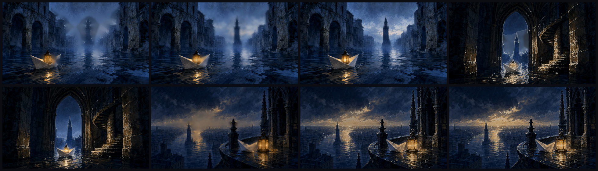
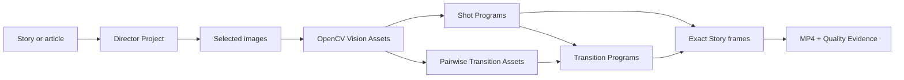

# Highpass Visual

[English](README.md) · [简体中文](README.zh-CN.md)

Highpass Visual is a local-first Codex plugin that turns a story, article, or essay into a directed, OpenCV-assisted animated film with deterministic frames and auditable quality evidence.

## Demo first: *The Last Lantern*


The complete 16-second film plays inline above. [Open the original 1280×720 MP4](docs/assets/the-last-lantern/the-last-lantern.mp4) for the full-quality H.264 render.

<details>
<summary>View the three-shot contact sheet</summary>



</details>

This three-shot fictional story was directed, visually compiled, animated, and published through the complete Highpass pipeline:

- 16 seconds, 384 exact frames, 1280×720, 24 fps, H.264/yuv420p.
- Shot animation combines low/high-frequency structure, contour drawing, signed distance reveals, saliency-guided camera movement, and mask-based 2.5D parallax.
- The first boundary selected a true two-image Cross Dissolve after optical flow and homography failed their recorded quality gates.
- The second boundary selected a Distance-field wipe after contour correspondence failed its coverage gate.
- The fallback decisions are intentional: advanced methods are used only when the images provide enough measurable evidence.

The renderer never darkens two independent shots and calls that a dissolve. Both adjacent Shot Programs are sampled over one shared Story-Time interval, and every published frame is tied back to its Program state and content hash.

## What it does



Highpass Visual provides:

- Director artifacts: Story Model, Beats, Shots, image specifications, selections, and narrative Transition Intent.
- OpenCV Vision Assets: Gaussian low-frequency layers, signed high-frequency detail, Canny structure, GrabCut or explicit soft masks, signed distance fields, contours, open strokes, saliency, foreground/context/background plates, and a depth proxy.
- Three Shot Treatments: Ink Reveal, Memory Focus, and Etched Light.
- Pairwise transitions: true Cross Dissolve, Distance-field wipe, ORB/RANSAC Homography dissolve, bidirectional Farneback Optical-flow dissolve, and Contour morph.
- Deterministic publication: absolute-time samplers, Chromium Canvas capture, exact PNG manifests, FFmpeg encoding, and tamper-evident Quality Evidence.
- Codex integration: one Skill for direction and workflow decisions plus a small MCP tool surface that exchanges file paths rather than image binaries.

## Requirements

- Node.js 20 or newer.
- Python 3.10 or newer.
- FFmpeg and FFprobe available on `PATH`.
- Chrome, Chromium, Edge, or a Playwright-managed Chromium shell.
- Codex CLI/App with local plugin support.

Image generation is optional. You can use Codex image generation or import your own local images. The MCP server itself does not call a third-party image model.

## Install in Codex

Clone and build the release bundle:

```bash
git clone https://github.com/mate-matt/highpass-visual.git
cd highpass-visual/plugins/highpass-visual
npm ci
npm run python:setup
npm run validate
npm run package:plugin
```

Register the repository as a local marketplace and install the plugin:

```bash
cd ../..
codex plugin marketplace add "$PWD"
codex plugin add highpass-visual@highpass-visual-local
```

`codex plugin add` prints the installed plugin root. Run the packaged Python setup once inside that installed root so the plugin has its isolated OpenCV runtime:

```bash
cd /path/printed/by/codex/plugin/add
node scripts/setup-python.mjs
```

Open a new Codex task and start with:

```text
Use $highpass-visual:direct-story-films to turn this story into an animated short film: …
```

The Skill begins with `inspect_runtime` and will report an actionable blocker instead of pretending a missing renderer or encoder is available.

## End-to-end usage

1. **Direct the source.** Turn the text into a Story Model, meaningful Beats, ordered Shots, one attention target per Shot, image specifications, and narrative Transition Intents (`continuity`, `reveal`, `atmospheric`, `dislocation`, or final `terminal`).
2. **Select images.** Generate or import Image Candidates, then explicitly select one content-hashed image for every Shot.
3. **Compile the Director Project.** Call `compile_director_project` to validate references, continuity, duration, selections, and overlap-safe transitions.
4. **Compile each image once.** Call `compile_vision_asset`. OpenCV outputs a content-addressed Vision Asset; OpenCV is not rerun for every animation frame.
5. **Choose a treatment.** Call `prepare_treatment_comparison` and compare Ink Reveal, Memory Focus, and Etched Light under the same image, seed, viewport, and duration.
6. **Compile adjacent transitions.** Call `compile_transition_asset` for every pairwise intent. Review thresholds, measurements, rejected methods, and the selected fallback.
7. **Prepare Transition Programs.** Call `prepare_transition_program` with both Shot Program/preview pairs and the Transition Asset. Inspect the endpoints and midpoint.
8. **Publish.** Call `publish_story` with ordered Shots, pairwise Transitions, and a Delivery Profile. Optional local audio and subtitle tracks are supported.
9. **Verify the evidence.** Keep the MP4, exact Story frame manifest, scene ranges, transition decisions, hashes, media inspection, and Quality Evidence together.

An offline starting fixture is included at [`plugins/highpass-visual/examples/director/the-signal`](plugins/highpass-visual/examples/director/the-signal). Delivery profiles, Vision recipes, and transition gates live under [`plugins/highpass-visual/presets`](plugins/highpass-visual/presets).

## Implementation approach

### 1. Narrative authority stays outside OpenCV

The Director decides what a boundary means; computer vision only decides whether a concrete visual method is safe. A `continuity` intent may prefer optical flow, but the Transition Compiler can reject it and fall back to Homography or Cross Dissolve. A locked advanced method fails explicitly when its evidence does not pass.

### 2. OpenCV compiles reusable visual structure

The Vision Compiler runs offline per Selected Image. It uses Gaussian blur and signed residuals for frequency separation, multiscale Canny edges for structure, GrabCut with deterministic morphology fallbacks for foreground proposals, distance transforms for continuous reveals, TELEA inpainting for bounded background hole filling, skeletonization for open strokes, and gradient-magnitude saliency for restrained camera targets.

Explicit grayscale masks preserve their soft alpha. A separate binary analysis mask drives contours, inpainting, and distance transforms. The 2.5D compositor uses a foreground RGBA plate, an inpainted background, a transparent context-ring middle plate, and a depth proxy; it does not claim learned or physically accurate depth.

### 3. Advanced transitions are quality-gated

- **Homography:** deterministic ORB features, Hamming matching, ratio filtering, RANSAC, inlier/reprojection/corner/overlap gates.
- **Optical flow:** bidirectional Farneback flow, forward/backward consistency, photometric confidence, directional occlusion maps, displacement limits, and local fallback to an unwarped Cross Dissolve.
- **Contours:** hierarchy-aware pairing, shape/area/centroid costs, equal arc-length resampling, winding normalization, and deterministic cyclic-start alignment.
- **Distance field:** the outgoing signed field controls continuous erosion with a feathered boundary.
- **Cross Dissolve:** always available as the honest two-image pairwise fallback.

### 4. Time is pure and seekable

Shot and Transition Samplers are pure functions of Program data and absolute time. Pairwise transitions sample the outgoing tail and incoming head simultaneously, so Story duration is `sum(Shot durations) - sum(pairwise overlaps)`. Seeking, resuming, browser rendering, and publication all derive the same state hash.

### 5. Publication binds pixels to evidence

Generated Shot/Transition previews are content-addressed by their Programs, embedded images, renderer runtime, child previews, and HTML hash. Optical-flow/confidence/occlusion rasters have byte hashes. Publication captures deterministic Canvas frames in Chromium, encodes them with FFmpeg, and records every source time, state hash, PNG hash, renderer identity, browser fingerprint, threshold, metric, and fallback in Quality Evidence.

## Privacy and security

- Story text, local images, masks, OpenCV compilation, Canvas capture, and FFmpeg publication stay local by default.
- The publication browser blocks non-local network requests; preview HTML uses a restrictive CSP.
- Large artifacts are written only under the explicit output roots supplied to MCP tools.
- `.env`, private keys, local agent instructions, internal scratch plans, outputs, releases, virtual environments, and dependency trees are ignored by Git.
- If you explicitly ask Codex to generate images, that external generation is separate from the local MCP pipeline.

## Development

```bash
cd plugins/highpass-visual
npm ci
npm run python:setup
npm run validate
```

The validation suite covers TypeScript contracts, Python/OpenCV compilation, all five transition renderers in Chromium, exact-frame Shot and Story publication, cache repair, evidence tamper detection, MCP contracts, packaging, and installed-bundle smoke tests.

## Scope boundaries

Highpass Visual does not currently provide lip sync, skeletal character animation, generative frame interpolation, automatic voice/music generation, learned semantic segmentation, or physically accurate monocular depth. WebGL2 is reported as an optional acceleration capability; canonical delivery uses deterministic Canvas pixels.

## License

[MIT](LICENSE). Third-party dependencies retain their own licenses; see [`THIRD_PARTY_NOTICES.md`](plugins/highpass-visual/THIRD_PARTY_NOTICES.md).
