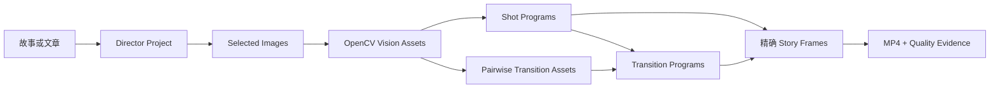

# Highpass Visual

[English](README.md) · [简体中文](README.zh-CN.md)

Highpass Visual 是一个本地优先的 Codex 插件：把故事、文章或散文编排为导演工程，使用 OpenCV 编译可复用的视觉结构，再生成确定性动画帧、MP4 和可审计的质量证据。

## 先看案例：《最后一盏灯》


上方会直接播放完整的 16 秒成片。[打开 1280×720 原始 MP4](docs/assets/the-last-lantern/the-last-lantern.mp4) 可观看完整质量的 H.264 版本。

<details>
<summary>查看三镜头接触表</summary>


</details>

这个三镜头虚构故事完整跑过了 Highpass 的导演、视觉编译、动画与发布管线：

- 16 秒、384 个精确帧、1280×720、24 fps、H.264/yuv420p。
- 镜头动画结合高低频结构、轮廓绘制、有符号距离场显影、显著性镜头运动和基于蒙版的 2.5D 视差。
- 第一处边界在光流与 Homography 未通过质量门后，选择了真正的双图 Cross Dissolve。
- 第二处边界在轮廓覆盖率不足后，选择了 Distance-field wipe。
- 降级不是缺陷：高级方法只有在图像提供了足够的可测证据时才会启用。

渲染器不会把两个独立淡黑冒充溶解。相邻两个 Shot Program 会在同一个 Story Time 重叠区间内同时采样，每个发布帧都能回溯到 Program 状态和内容哈希。

## 它能做什么



Highpass Visual 包含：

- 导演产物：Story Model、Beat、Shot、图像规格、选图记录和叙事 Transition Intent。
- OpenCV Vision Asset：高斯低频层、有符号高频细节、Canny 结构、GrabCut 或显式软蒙版、有符号距离场、轮廓、开放笔画、显著性、前景/上下文/背景 plate 与深度代理。
- 三种 Shot Treatment：Ink Reveal、Memory Focus、Etched Light。
- 成对转场：真正的 Cross Dissolve、Distance-field wipe、ORB/RANSAC Homography dissolve、双向 Farneback Optical-flow dissolve、Contour morph。
- 确定性发布：绝对时间采样器、Chromium Canvas 捕获、精确 PNG manifest、FFmpeg 编码和可验篡改的 Quality Evidence。
- Codex 集成：一个负责导演判断和流程编排的 Skill，加上一组只交换文件路径、不把图像二进制塞进上下文的 MCP 工具。

## 环境要求

- Node.js 20 或更高版本。
- Python 3.10 或更高版本。
- `PATH` 中可用的 FFmpeg 与 FFprobe。
- Chrome、Chromium、Edge，或 Playwright 管理的 Chromium shell。
- 支持本地插件的 Codex CLI/App。

图像生成不是必需项。可以使用 Codex 图像生成，也可以导入本地图像；MCP 服务本身不会调用第三方图像模型。

## 安装到 Codex

克隆并构建发布包：

```bash
git clone https://github.com/mate-matt/highpass-visual.git
cd highpass-visual/plugins/highpass-visual
npm ci
npm run python:setup
npm run validate
npm run package:plugin
```

把仓库注册成本地 marketplace 并安装插件：

```bash
cd ../..
codex plugin marketplace add "$PWD"
codex plugin add highpass-visual@highpass-visual-local
```

`codex plugin add` 会输出安装后的插件根目录。进入该目录执行一次打包内的 Python 初始化，使安装副本拥有隔离的 OpenCV 环境：

```bash
cd /codex/plugin/add/输出的安装目录
node scripts/setup-python.mjs
```

开启一个新的 Codex 任务，输入：

```text
使用 $highpass-visual:direct-story-films，把这段故事制作成动画短片：……
```

Skill 会先调用 `inspect_runtime`；缺少渲染器或编码器时，它会给出可执行的阻塞原因，而不会假装已经具备能力。

## 完整使用流程

1. **导演原文。** 把文本编排为 Story Model、具有明确变化的 Beat、有序 Shot、每镜头唯一注意目标、图像规格和叙事 Transition Intent（`continuity`、`reveal`、`atmospheric`、`dislocation`、最终 `terminal`）。
2. **选择图像。** 生成或导入 Image Candidate，然后为每个 Shot 明确选择一个带内容哈希的图像。
3. **编译导演工程。** 调用 `compile_director_project`，验证引用、连续性、时长、选图和安全的重叠区间。
4. **每张图只编译一次。** 调用 `compile_vision_asset`。OpenCV 输出内容寻址的 Vision Asset，不会在每个动画帧重复执行。
5. **选择 Treatment。** 调用 `prepare_treatment_comparison`，在相同图像、seed、视口与时长下比较三种方案。
6. **编译相邻转场。** 对每个成对 intent 调用 `compile_transition_asset`，检查阈值、实测指标、被拒方法和最终降级。
7. **准备 Transition Program。** 用两侧 Shot Program/preview 和 Transition Asset 调用 `prepare_transition_program`，检查起点、中点和终点。
8. **发布成片。** 用有序 Shots、成对 Transitions 和 Delivery Profile 调用 `publish_story`；可选本地音频与字幕。
9. **保留证据。** 将 MP4、精确 Story frame manifest、镜头区间、转场决策、哈希、媒体检查和 Quality Evidence 一起保存。

离线起步样例位于 [`plugins/highpass-visual/examples/director/the-signal`](plugins/highpass-visual/examples/director/the-signal)；Delivery Profile、Vision Recipe 与转场门槛位于 [`plugins/highpass-visual/presets`](plugins/highpass-visual/presets)。

## 实现思路

### 1. 叙事权归导演，OpenCV 不替代导演

Director 决定边界“为什么存在”，计算机视觉只判断某个具体视觉算法是否安全。`continuity` 可以优先尝试光流，但 Transition Compiler 可以拒绝它并降级到 Homography 或 Cross Dissolve。被锁定的高级方法如果证据不足，会明确失败。

### 2. OpenCV 负责编译可复用视觉结构

Vision Compiler 对每个 Selected Image 离线执行一次：高斯模糊与有符号残差负责频率分离；多尺度 Canny 提取结构；GrabCut 配合确定性形态学回退提出前景；Distance Transform 支持连续显影；TELEA inpainting 做受限背景补洞；骨架化产生开放笔画；梯度显著性为克制的镜头运动提供目标。

显式灰度蒙版会保留软 alpha，二值分析蒙版另行派生，用于轮廓、补洞和距离场。2.5D 合成使用前景 RGBA plate、补洞背景、透明上下文环中景和深度代理，不声称这是学习式或物理真实深度。

### 3. 高级转场必须通过质量门

- **Homography：** 确定性 ORB、Hamming 匹配、ratio filter、RANSAC，以及内点、重投影、角点和重叠覆盖门槛。
- **Optical flow：** 双向 Farneback、前后向一致性、光度置信度、分方向遮挡图、位移限制；低可靠区域局部回退到未扭曲 Cross Dissolve。
- **Contours：** 层级感知配对、形状/面积/中心代价、等弧长采样、绕向统一和确定性循环起点对齐。
- **Distance field：** 用上一镜头的有符号距离场连续侵蚀，边界保持羽化。
- **Cross Dissolve：** 永远可用、真正同时显示两张图的成对安全回退。

### 4. 时间必须纯函数化、可任意 seek

Shot/Transition Sampler 都是 Program 数据与绝对时间的纯函数。成对转场同时采样 outgoing tail 和 incoming head，因此 Story 时长为 `Shot 时长总和 - 成对重叠总和`。seek、恢复、浏览器预览和发布会得到相同的 state hash。

### 5. 发布像素必须能回溯到证据

Shot/Transition Preview 的内容地址包含 Program、嵌入图像、renderer runtime、子 preview 和 HTML 哈希。光流、置信度与遮挡栅格都有字节哈希。发布阶段由 Chromium 捕获确定性 Canvas 帧，再由 FFmpeg 编码；每个 source time、state hash、PNG hash、renderer identity、浏览器指纹、阈值、指标和降级原因都会写入 Quality Evidence。

## 隐私与安全

- 故事文本、本地图像、蒙版、OpenCV 编译、Canvas 捕获和 FFmpeg 发布默认全部留在本机。
- 发布浏览器阻止非本地网络请求；Preview HTML 使用限制性 CSP。
- 大型产物只写入 MCP 请求明确给出的 output root。
- `.env`、私钥、本地 agent 指令、内部 scratch 计划、outputs、release、虚拟环境和依赖目录不会进入 Git。
- 只有在你明确要求 Codex 生成图像时，才会发生与本地 MCP 管线分离的外部生成调用。

## 开发与测试

```bash
cd plugins/highpass-visual
npm ci
npm run python:setup
npm run validate
```

测试覆盖 TypeScript 合同、Python/OpenCV 编译、五种转场的 Chromium 渲染、精确帧 Shot/Story 发布、缓存修复、证据篡改检测、MCP 合同、插件打包和安装包冒烟。

## 能力边界

当前不包含口型同步、骨骼角色动画、生成式帧插值、自动配音配乐、学习式语义分割或物理准确的单目深度。WebGL2 只作为可选加速能力报告；规范发布使用确定性 Canvas 像素。

## 许可证

[MIT](LICENSE)。第三方依赖保留各自许可证，详见 [`THIRD_PARTY_NOTICES.md`](plugins/highpass-visual/THIRD_PARTY_NOTICES.md)。
