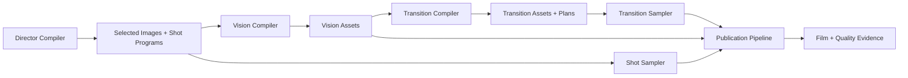

# Module boundaries

Highpass Visual is organized around six deep modules. Each interface hides a large implementation and is also the highest practical test seam.

## Director Compiler

**Interface:** compile Source Material and a director brief into a validated Story Model, Beats, Shots, image specifications, and Shot Programs.

The module owns narrative interpretation, continuity, attention, Treatment selection, and artifact dependencies. It does not generate pixels, invoke OpenCV, or encode video. In the Codex product, its primary adapter is the director Skill; deterministic validators remain reusable code behind the same interface.

## Vision Compiler

**Interface:** compile one Selected Image and one typed compilation recipe into a content-addressed Vision Asset manifest.

The module hides color conversion, scale-space decomposition, edge detection, morphology, segmentation fallback, path extraction, path prioritization, distance fields, caching, and OpenCV capability differences. Callers do not orchestrate individual OpenCV functions. The production adapter is a Python/OpenCV worker behind a TypeScript MCP facade; tests may use fixture images through the same compile interface.

## Transition Compiler

**Interface:** compile two adjacent Vision Assets and one Transition Intent into a content-addressed Transition Asset and quality-gated Transition Plan.

The module owns GrabCut-derived masks, ORB feature matching, RANSAC homography, bidirectional optical flow, occlusion and confidence estimation, contour correspondence, mask-based 2.5D layers, compatibility measurements, method selection, deterministic fallbacks, and locked-method rejection. Callers request a narrative intent, not individual OpenCV operations.

## Shot Sampler

**Interface:** sample a validated Shot Program at an absolute Scene Time and return a complete Visual State.

The module owns phase timing, easing, path reveal progress, layer weights, camera intent, Treatment parameters, and stable state hashes. It is pure for a fixed program and input log. Preview playback and fixed-frame export call the same interface.

## Transition Sampler

**Interface:** sample a validated Transition Program at one absolute Transition Time and return the outgoing Scene Time, incoming Scene Time, method progress, camera states, and a stable state hash.

The sampler maps one shared interval onto the outgoing Shot tail and incoming Shot head. It has no wall-clock state and performs no vision analysis. The browser renderer consumes the sampled state and precompiled Transition Asset.

## Publication Pipeline

**Interface:** publish a Story Project for a Delivery Profile and return the media artifact plus Quality Evidence.

The module owns renderer readiness, fixed-frame capture, resumable frame output, FFmpeg invocation, audio/subtitle assembly, media inspection, and release gates. The first implementation uses one browser renderer, so no renderer seam is introduced yet. A renderer interface becomes real only when a second Canvas/WebGL adapter is implemented.

## Integration shape

## Explicit non-seams

- Individual OpenCV operations are implementation details of the Vision Compiler.
- Individual feature, flow, segmentation, distance, contour, and inpainting operations are implementation details of the Transition Compiler.
- Image generation is an adapter used by the director Skill; imported images satisfy the same Selected Image contract.
- FFmpeg commands are implementation details of the Publication Pipeline.
- MCP is a transport and capability surface, not a domain module.
- Plugin packaging is a distribution concern, not narrative or rendering truth.
