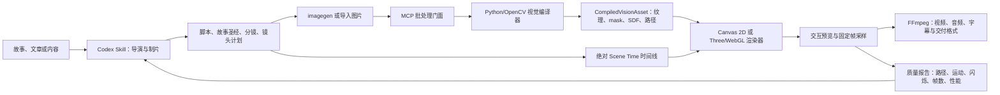

# Highpass Visual：基于一手资料的技术可行性研究

> 研究范围：OpenCV 图像处理、Canvas/WebGL/Three.js 动画、浏览器与本地视频编码、MCP + Codex plugin + skill 职责边界。本文只引用 OpenCV、MDN/W3C、Three.js、FFmpeg、OpenAI/Codex 的官方文档或标准。文中明确标记“工程判断”的内容是依据官方能力作出的设计推论，不是官方文档原话。

## 结论先行

方案可行，而且有机会形成很鲜明的视觉语言。真正有价值的部分不是“给图片做一次高通滤波”，而是把 OpenCV 产出的多种结构表示——低频底图、高频残差、细边、对象轮廓、距离场、形态学层级——变成可按时间编排的动画通道。

建议采用两段式架构：离线分析阶段用原生 OpenCV 对每张故事图预计算结构资产；实时预览阶段只在 Canvas/WebGL 中播放路径、纹理、遮罩和 shader，不要逐帧把 GPU 图像读回 CPU 再跑 OpenCV。最终成片使用固定时间步离线渲染并交给 FFmpeg 编码，浏览器 `captureStream()` / `MediaRecorder` 只作为快速预览导出。

更准确的产品定位是：**OpenCV 是 compile-time visual compiler（编译期视觉编译器），不是浏览器逐帧滤镜**。它把故事图“编译”为可复用的频带纹理、mask、距离场、轮廓路径与质量指标；运行时只采样这些资产。滤波本身很可能不是瓶颈，数百至数千条碎路径的筛选、平滑、合批和导演排序更可能决定预览性能与成片观感。

美术质量的上限不会由 Canny 决定，而会由五件事决定：图像生成时的构图一致性、线条的语义分级、路径清理与简化、显隐节奏、以及原图/模糊图/线稿之间的调色和混合。OpenCV 能很好地提供后四项所需的底层信号，但“导演判断”仍应由 skill/模型工作流负责。

## 推荐系统架构



这条链路有三个关键边界：图片生成可以是非确定性的，但一经选中就按内容哈希锁定；OpenCV 编译、时间采样和渲染必须尽量确定性；审美反馈只改显式导演 artifact 或有界参数，不让 renderer 临时猜测故事意图。

## 1. OpenCV 如何支撑审美动画

### 1.1 不要只保留一张“高通图”，而要保留多尺度结构

OpenCV 官方将低通用于去噪与模糊、高通用于寻找边缘，并提供 `filter2D()` 做任意二维卷积；`GaussianBlur()`、中值滤波和双边滤波则提供不同的保边/去噪权衡。特别是双边滤波会去掉表面纹理但尽量保留边缘，不过官方也指出它比其他滤波慢。[OpenCV：Smoothing Images](https://docs.opencv.org/4.x/d4/d13/tutorial_py_filtering.html)

因此建议为每张图离线生成一个“结构金字塔”，而不是单一边缘图：

- `base_sigma = GaussianBlur(image, sigma)`：低频氛围底图，可做由模糊到清晰、记忆感、景深呼吸。
- `detail_sigma = image - base_sigma`：高频残差，可做细节逐渐浮现、局部锐化、纸张/材质纹理闪现。这是由低通定义推导出的工程表示。
- `laplacian_sigma = Laplacian(base_sigma)`：二阶变化响应，适合比 Canny 更“电光/蚀刻”的明暗轮廓。OpenCV 官方说明 Laplacian 用二阶导数检测边缘，示例也先用 Gaussian blur 降噪，并使用有符号深度避免溢出。[OpenCV：Laplacian Operator](https://docs.opencv.org/4.x/d5/db5/tutorial_laplace_operator.html)
- 多个 `sigma` 同时保留：大尺度对应主体/大块明暗，小尺度对应纹理/毛发/建筑细节。动画可以先显大结构、后显小结构，天然形成视觉叙事层次。这是工程判断。

这里有两个重要限制：第一，高通会同时增强真实边缘和噪声；第二，直接把有符号高通压成 8 位会丢失正负方向。因此生产实现应保留 float/16-bit 中间结果，分别控制正边与负边，直到生成最终纹理时才映射到显示范围。

### 1.2 Canny 适合做“干净的细线层”，不适合独自承担对象理解

Canny 是多阶段算法：Gaussian 去噪、Sobel 梯度、非极大值抑制、双阈值滞后连接。非极大值抑制产生细边；滞后阈值保留连接到强边的弱边并丢弃孤立响应。[OpenCV：Canny Edge Detection](https://docs.opencv.org/4.x/da/d22/tutorial_py_canny.html)

这使它非常适合生成可动画的细节线层，但阈值不能固定成全项目常数。建议把配置做成每镜头可覆盖的 preset，并至少记录 `blurSigma`、`thresholdLow`、`thresholdHigh`、`apertureSize`、`L2gradient`。可以用以下视觉角色拆层：

- 低阈值 Canny：信息丰富，适合短暂闪现的“感知/扫描”层。
- 高阈值 Canny：只保留强结构，适合长期停留的主轮廓层。
- Laplacian/高通：保留正负亮度变化和更丰富纹理，适合光晕、蚀刻、颗粒层。
- 对象 mask 的轮廓：承担真正的主体剪影和闭合遮罩。

工程判断：只把 Canny 二值图 `findContours()` 后逐条画出来，常会得到双边界、碎片和无语义纹理，视觉上更像技术演示而非成片。因此 Canny 应是“细节线源”，对象 mask 才是“主轮廓源”。

### 1.3 轮廓提取能转成路径，但必须保留层级并简化

OpenCV 将 contour 定义为连接连续边界点的曲线；官方建议先提供二值图，通常先 threshold 或 Canny。`findContours()` 输出轮廓与层级，每条轮廓就是边界点坐标；`CHAIN_APPROX_SIMPLE` 会压缩直线段上的冗余点。[OpenCV：Contours Getting Started](https://docs.opencv.org/4.x/d4/d73/tutorial_py_contours_begin.html)

`arcLength()` 可计算曲线长度，`approxPolyDP()` 可按最大误差简化曲线，`moments()`、`contourArea()` 可得到质心和面积。[OpenCV：Contour Features](https://docs.opencv.org/4.x/dd/d49/tutorial_py_contour_features.html)

推荐的路径资产不是裸点数组，而是带元数据的结构：

```json
{
  "id": "shot-03/subject/outer-01",
  "closed": true,
  "hierarchy": { "parent": null, "depth": 0 },
  "points": [[0.12, 0.36], [0.13, 0.35]],
  "length": 0.84,
  "area": 0.19,
  "centroid": [0.48, 0.55],
  "source": "mask-contour",
  "strength": 0.91,
  "styleRole": "hero-outline"
}
```

坐标应归一化，便于不同预览/导出分辨率复用。路径按面积、周长、平均梯度、层级深度、距视觉中心距离等排序，再由导演脚本指定出现顺序。`approxPolyDP` 的 epsilon 应相对周长设置，并为主轮廓、次级轮廓、纹理线分别设不同精度。OpenCV 输出的是折线；如果需要手绘般平滑的 Bézier，需要在其后增加曲线拟合/平滑步骤，这是工程判断，不应把该能力误归给 `findContours()`。

### 1.4 形态学是“线条美术清理器”

OpenCV 官方说明：腐蚀会缩小前景并移除小白噪声；膨胀可连接断裂部分；开运算（先腐蚀后膨胀）用于去噪；闭运算（先膨胀后腐蚀）用于封小洞；形态学梯度是膨胀与腐蚀之差，结果类似对象轮廓。结构元可以是矩形、椭圆、十字等。[OpenCV：Morphological Transformations](https://docs.opencv.org/4.x/d9/d61/tutorial_py_morphological_ops.html)

这组算子可以直接变成可调的艺术控制：

| 算子 | 预处理用途 | 可动画视觉用途 |
| --- | --- | --- |
| opening | 删除孤立点、细碎纹理 | 控制线稿“洁净度” |
| closing | 连接断线、封小洞 | 让路径可形成连续描边/遮罩 |
| dilation | 加粗 mask/线条 | 墨迹扩散、光晕外扩 |
| erosion | 收缩 mask/线条 | 擦除、退潮、内收消失 |
| morphological gradient | 得到指定粗细的轮廓带 | 轮廓脉冲、霓虹边缘 |
| top-hat / black-hat | 分离局部亮/暗细节 | 高光或暗纹独立闪现 |

结构元本身也是风格参数：椭圆核更柔和，十字/矩形核更机械；核尺寸可映射为“笔触半径”。形态学建议只在离线资产生成时执行，不要每帧重复计算相同结果。

### 1.5 距离变换是最值得充分利用的 OpenCV 能力之一

`distanceTransform()` 会把二值图中每个前景像素替换成它到最近背景像素的距离。[OpenCV：Distance Transform and Watershed](https://docs.opencv.org/4.x/d2/dbd/tutorial_distance_transform.html)

由此可构造连续的标量场，而不只是“有边/无边”：

- 对对象 mask 做距离变换，用 `distance < progress * maxDistance` 形成从边缘向内部生长的 reveal。
- 同时对 mask 与反 mask 做距离变换并相减，可构造近似 signed distance field；用 `smoothstep()` 控制柔边、光晕、墨迹扩张。这是基于单侧距离变换的工程组合。
- 以质心、导演指定锚点或路径弧长为种子，生成从某个叙事焦点扩散的显现。
- 把距离值作为 shader 纹理，GPU 每帧只更新一个 progress uniform，就能得到平滑且廉价的扩张、侵蚀、描边宽度变化。

距离场比每帧运行 dilation/erosion 更适合动画：一次预计算即可连续控制亚像素级边界，避免核尺寸按整数跳变造成的抖动。这是工程判断。

### 1.6 推荐的 OpenCV 资产流水线

```text
生成图
  -> 色彩/亮度标准化
  -> 多尺度 Gaussian / bilateral
  -> 高频残差 + Laplacian + 多档 Canny
  -> threshold / adaptive threshold / 对象 mask
  -> morphology 清理
  -> findContours + hierarchy
  -> approxPolyDP + 元数据分级
  -> distanceTransform
  -> 输出 PNG/EXR 纹理 + JSON 路径/参数
```

当图像局部光照差异大时，OpenCV 的 adaptive threshold 会根据像素周边区域计算不同阈值；Otsu 则从直方图自动选择全局阈值。官方示例也展示了先 Gaussian 去噪再做 Otsu 可改善噪声图的结果。[OpenCV：Image Thresholding](https://docs.opencv.org/4.x/d7/d4d/tutorial_py_thresholding.html)

工程上应把每一步的输入、参数、输出 checksum 写入 manifest，以便复现和缓存。图像分析结果应以内容哈希缓存：相同源图与参数不再重算。

### 1.7 把“闭合区域、开放笔触、纹理响应”分成三类几何

这是路径质量最容易出错的地方。`findContours()` 适合闭合对象 mask 和有洞的区域；一像素 Canny 线送入 `findContours()` 后，常会得到沿线条两侧折返的窄闭合轮廓，而不是理想的单笔中心线。因此建议明确维护三种资产：

1. **Region contour**：来自人物、道具、建筑等语义 mask，用 `findContours(RETR_TREE)` 保留父子层级，承担填充、剪裁和主体外轮廓。
2. **Open stroke**：来自 Canny 后的骨架/边段。OpenCV `ximgproc.thinning()` 可把二值 blob 骨架化；`ximgproc::EdgeDrawing` 会连接像素并直接返回连续 edge segments，更适合作为开放笔触候选。[OpenCV：ximgproc thinning](https://docs.opencv.org/4.x/df/d2d/group__ximgproc.html) [OpenCV：Edge Drawing](https://docs.opencv.org/4.x/d4/d8b/group__ximgproc__edge__drawing.html) [OpenCV：EdgeDrawing segments](https://docs.opencv.org/4.x/d1/d1c/classcv_1_1ximgproc_1_1EdgeDrawing.html)
3. **Raster response**：Laplacian、高频残差、top-hat、black-hat 等保留为纹理，不强行全部矢量化；它们由 shader 控制透明度、颜色和局部光效。

闭合路径走 even-odd 填充，开放路径按累计弧长绘制，纹理响应走 GPU 混合。把三者混在一个 contour 列表里，会同时损害拓扑、性能与美术控制。

### 1.8 分割与光流只能作为受控增强

最好在图片生成或选图阶段同时取得主体 mask；OpenCV 的 GrabCut 可从矩形和人工前/背景标记迭代提取前景，marker-based watershed 可分开接触对象，但两者都需要可靠先验，不能等同于通用语义分割。[OpenCV：GrabCut](https://docs.opencv.org/4.x/d8/d83/tutorial_py_grabcut.html) [OpenCV：Watershed](https://docs.opencv.org/4.x/d3/db4/tutorial_py_watershed.html)

OpenCV 也提供 Farneback 等稠密 optical flow。它可以用于同一镜头的相邻、构图一致的姊妹关键帧之间做局部 warp，或测量一段已有视频的运动场；它不适合在两张角色姿态、视角、背景都不同的独立生成图之间制造可信运动。[OpenCV：Farneback optical flow](https://docs.opencv.org/4.x/dc/d6b/group__video__track.html)

因此产品应把“同源近邻帧”标成可使用光流，把普通镜头切换保持为导演设计的淡化、遮罩、频带过渡或 2.5D 相机运动。这样既利用 OpenCV，也不会让错误对应关系产生橡皮般扭曲。

## 2. Canvas、WebGL 与 Three.js 的可行能力

### 2.1 Canvas 2D 足以完成优质的纯 2D 版本

`Path2D` 可保留并重复绘制由 `moveTo`、`lineTo`、quadratic/cubic Bézier 等命令组成的路径，而且可在 Web Worker 中使用。[MDN：Path2D](https://developer.mozilla.org/en-US/docs/Web/API/Path2D) Canvas 2D 还提供 `globalAlpha`、`globalCompositeOperation` 与 `drawImage()`，能把路径、原图、模糊底图、边缘纹理按透明度和混合模式组合。[MDN：CanvasRenderingContext2D](https://developer.mozilla.org/en-US/docs/Web/API/CanvasRenderingContext2D)

因此纯 2D MVP 可以实现：

- 路径按累计弧长逐段出现；
- 原图以线条/距离场作为 `source-in` 或 `destination-in` 遮罩显现；
- 多层图像用 `screen`、`multiply`、`lighter` 等合成产生发光/墨色效果；
- 通过 `globalAlpha` 做明暗呼吸、交叉淡化；
- 预先生成的 blur 纹理与清晰纹理交叉混合。

Canvas 的 `filter` 支持 Gaussian blur、brightness、contrast、opacity 等，但 MDN 标记该属性并非所有主流浏览器都达到 Baseline，因此它可用于增强，不能作为唯一的生产依赖；关键模糊层应由 OpenCV 离线生成或由 WebGL shader 实现。[MDN：Canvas 2D filter](https://developer.mozilla.org/en-US/docs/Web/API/CanvasRenderingContext2D/filter)

工程判断：如果画面主要是 1–3 张全屏图、数百条路径、少量粒子和 2D 相机运动，Canvas 2D 是最短、最可控的路线。路径数量与动态像素效果明显增大后，再切到 GPU。

### 2.2 WebGL/Three.js 适合大量路径、距离场和后期特效

WebGL 提供纹理、framebuffer、shader 与独立 RGB/alpha 混合函数，可在 GPU 中组合多个图像通道。[MDN：WebGLRenderingContext](https://developer.mozilla.org/en-US/docs/Web/API/WebGLRenderingContext) Three.js 的 render target 是 GPU 离屏缓冲，可把一次渲染结果当纹理继续做后处理；官方的 `EffectComposer` 流程就是先渲染到 render target，再按顺序应用 pass，并支持自定义 `ShaderPass`。[Three.js：RenderTarget](https://threejs.org/docs/pages/RenderTarget.html) [Three.js：Post Processing](https://threejs.org/manual/en/how-to-use-post-processing.html)

`ShaderMaterial` 允许写 GLSL 自定义 GPU 效果，并且 uniform 每帧更新后会立即反映到 shader 中。[Three.js：ShaderMaterial](https://threejs.org/docs/pages/ShaderMaterial.html) 这很适合：

- 用距离场纹理 + `smoothstep` 做连续 reveal/outline/glow；
- 用低频/原图/高频三张纹理在一个 fragment shader 中调色混合；
- 用噪声扰动阈值，得到不规则墨迹扩散；
- 把路径累计距离作为 vertex attribute，用 progress uniform 控制描线；
- render target 之间做 bloom、拖影、局部模糊、色差、颗粒。

原生 WebGL/Three 的基础 line primitive 通常只有 1 像素；Three.js 官方 `ShaderMaterial.linewidth` 文档明确说明 WebGL/WebGPU 会忽略普通线宽设置。若要宽线，应使用 `Line2` + `LineMaterial`，它支持任意线宽、虚线、透明度和 alpha-to-coverage 抗锯齿。[Three.js：ShaderMaterial linewidth 限制](https://threejs.org/docs/pages/ShaderMaterial.html) [Three.js：Line2](https://threejs.org/docs/pages/Line2.html) [Three.js：LineMaterial](https://threejs.org/docs/pages/LineMaterial.html)

工程判断：Three.js 在本项目中的价值不是“做 3D”，而是提供成熟的 GPU 资源、宽线与后处理组织层。可以只用正交相机和屏幕空间 quad；只有需要 2.5D 分层、景深、镜头推进或空间粒子时才引入真实深度。

### 2.3 推荐的渲染分层

```text
Layer 0  atmosphere: 低频模糊底图、渐变、颗粒
Layer 1  primary image: 原图/调色图
Layer 2  reveal mask: 对象 mask、距离场、导演遮罩
Layer 3  hero paths: 主体闭合轮廓、粗线
Layer 4  detail paths: Canny/Laplacian 细节线
Layer 5  accents: 光晕、粒子、文字、镜头过渡
```

每层只接受确定性的时间参数 `t`，不依赖真实墙钟。预览时 `t` 来自 `requestAnimationFrame`；导出时 `t = frameIndex / fps`。这样同一份镜头脚本可在 Canvas 与 Three/WebGL 后端复现。

## 3. 编码、透明度与性能边界

### 3.1 浏览器有两种导出路线，但定位不同

`HTMLCanvasElement.captureStream()` 可把 canvas 实时内容变成单轨 `MediaStream`，可指定帧率；帧率设为 0 时可以通过 track 的 `requestFrame()` 手动请求帧。[MDN：HTMLCanvasElement.captureStream](https://developer.mozilla.org/en-US/docs/Web/API/HTMLCanvasElement/captureStream) `MediaRecorder` 能把 MediaStream 录成浏览器选择/支持的 WebM 或 MP4 等容器，且必须用 `MediaRecorder.isTypeSupported()` 运行时探测 MIME 支持。[MDN：MediaRecorder](https://developer.mozilla.org/en-US/docs/Web/API/MediaRecorder)

它非常适合“用户点一下快速预览导出”，但容器、codec、码率行为依赖 user agent，不应作为唯一高质量交付路径。

WebCodecs 的 `VideoEncoder` 提供更低层的逐帧编码、`isConfigSupported()`、`encodeQueueSize`/`dequeue` 背压，并可在 Dedicated Worker 中运行；规范明确指出 user agent 不必支持任何特定 codec/config。[W3C：WebCodecs](https://www.w3.org/TR/webcodecs/) 因此浏览器离线导出应先探测配置，再按 `encodeQueueSize` 限流，编码后立即 `VideoFrame.close()` 释放资源；规范明确说明 close 会释放媒体资源引用并降低内存压力。[W3C：WebCodecs memory model](https://www.w3.org/TR/webcodecs/#memory-model)

### 3.2 透明视频必须视为“目标相关能力”

WebCodecs 的 `VideoEncoderConfig.alpha` 默认是 `discard`；`alpha: "keep"` 表示 user agent 应尽量保留输入 `VideoFrame` 的 alpha，但 codec/config 是否支持仍需 `isConfigSupported()` 探测。硬件加速选项也只是提示，user agent 可以忽略。[W3C：WebCodecs AlphaOption / HardwareAcceleration](https://www.w3.org/TR/webcodecs/#alpha-option)

因此建议定义两种正式输出：

1. **交付成片**：预先合成背景，输出广泛可播放的非透明 MP4/H.264 或其他目标格式。
2. **后期中间件**：保留 RGBA PNG 序列，或在本地使用支持 alpha 的目标编码。FFmpeg 官方提供 ProRes `4444` / `4444xq` profiles，并提供 `alphaextract`/`alphamerge` 在不支持 alpha 的格式中把颜色与 alpha 分开存储/重建。[FFmpeg：ProRes encoder](https://ffmpeg.org/ffmpeg-codecs.html#ProRes) [FFmpeg：alphaextract / alphamerge](https://ffmpeg.org/ffmpeg-filters.html#alphaextract)

不要在产品文案中笼统承诺“浏览器都能导出透明视频”；应在目标平台做 codec + alpha 的实际能力探测，并为不支持时提供 PNG 序列/本地 FFmpeg fallback。

### 3.3 最终导出优先本地 FFmpeg

FFmpeg 的 image2 demuxer可按文件名模式读取帧序列；filtergraph 提供 `overlay`、`blend`、`fade`、`alphamerge` 等操作，编码器和容器选择也比浏览器稳定。[FFmpeg：image2](https://ffmpeg.org/ffmpeg-formats.html#image2) [FFmpeg Filters](https://ffmpeg.org/ffmpeg-filters.html)

推荐流程：

```text
固定 fps 逐帧渲染 RGBA
  -> PNG sequence 或 rawvideo pipe
  -> FFmpeg 合成音频/字幕/转场
  -> 交付版 MP4
  -> 可选透明中间版 MOV ProRes 4444 / RGBA 序列
```

固定帧序列虽然比实时录制占磁盘，但最容易断点续渲染、定位坏帧、复现结果，也能让视觉质量与机器实时性能解耦。原型后期可改为 rawvideo pipe 降低 I/O；这是工程优化，不影响资产和镜头脚本模型。

### 3.4 性能的核心原则是“OpenCV 离线，GPU 在线，避免每帧读回”

`OffscreenCanvas` 可把 Canvas 2D/WebGL 渲染移到 Worker，降低主线程压力。[MDN：OffscreenCanvas](https://developer.mozilla.org/en-US/docs/Web/API/OffscreenCanvas) Canvas 官方优化建议包括预渲染重复对象、复杂场景分层、避免每帧缩放大图。[MDN：Optimizing canvas](https://developer.mozilla.org/en-US/docs/Web/API/Canvas_API/Tutorial/Optimizing_canvas)

WebGL 官方最佳实践指出，CPU `readPixels()` 会触发 GPU 完成工作并往返读取，造成同步 stall；纹理上传也可能刷新 pipeline。它还建议批量 draw call、控制每像素 VRAM、必要时降低 back buffer 分辨率。[MDN：WebGL best practices](https://developer.mozilla.org/en-US/docs/Web/API/WebGL_API/WebGL_best_practices)

由此得到本项目的性能红线：

- OpenCV 只处理生成后的静态故事图或少量关键帧，结果缓存。
- 每帧不做 `canvas -> readPixels -> OpenCV -> upload texture` 闭环。
- 路径合批；细节线尽量按 style/material 合成少量 geometry/draw call。
- 距离场、边缘、低频图上传一次，动画只改 uniform。
- 1080p/4K 导出与实时预览使用不同 render scale；预览可 0.5–0.75 倍分辨率。
- WebCodecs 编码必须有 queue backpressure；所有 VideoFrame/纹理/render target 在生命周期结束时显式释放。

### 3.5 本机单图指示性基准（本地证据，不是官方结论）

本机环境检查显示 Python `cv2=4.13.0` 且 `ximgproc` 可用；FFmpeg `7.1` 可用，并含 `libx264`、`libx265`、`libvpx-vp9`、`prores_ks` 与 VideoToolbox。对一张 `1586×992` 参考图做的单图测试，中位耗时如下：

| 操作 | 中位耗时 |
| --- | ---: |
| Gaussian blur | 0.70 ms |
| guidedFilter | 32.08 ms |
| Canny | 1.15 ms |
| morphology close | 0.30 ms |
| thinning | 18.08 ms |
| findContours | 2.13 ms |
| EdgeDrawing | 约 91 ms |

同一张图的 `Canny + close` 产生 788 条 contours、73,998 个原始点；`approxPolyDP` 使用周长的 1% 作为 epsilon 后仍保留 776 条路径，但点数降至 10,414，减少 85.9%。这只是单台机器、单张图片、特定参数的指示性结果，不能当作通用性能保证；它支持两个架构判断：常规 OpenCV 滤波足够快到适合资产编译，路径条数与拓扑并不会因点数简化自动大幅下降，因此**路径管理比滤波计算更可能成为瓶颈**。P0 必须同时测路径数、总顶点、连通性和渲染 draw calls，不能只测算子毫秒数。

## 4. MCP + Codex plugin + skill 的职责边界

OpenAI 官方把 MCP 定位为把模型连接到工具与上下文；Codex 支持本地 STDIO 和远程 Streamable HTTP MCP server，server 可提供 tools 和初始化 instructions。[OpenAI：Codex MCP](https://developers.openai.com/codex/mcp) 官方把 skill 定义为任务专用的指令、资源和可选脚本，并建议每个 skill 聚焦一个工作；plugin 则是分发边界，可以同时打包 skills、MCP server 配置、apps、hooks 和资产。[OpenAI：Build skills](https://developers.openai.com/codex/skills) [OpenAI：Build plugins](https://learn.chatgpt.com/docs/build-plugins)

### 推荐边界

| 层 | 应负责 | 不应负责 |
| --- | --- | --- |
| **Skill（导演工作流）** | 解析故事、节拍表、分镜、镜头目的、imagegen prompt、视觉 preset 选择、镜头审片与返工规则；编排工具调用 | 自己实现 OpenCV/FFmpeg；隐藏确定性参数；把大二进制塞进上下文 |
| **MCP server（确定性能力面）** | 图像分析、路径提取、资产缓存、镜头渲染、编码、状态查询、artifact manifest；参数校验和结构化结果 | 决定故事重点、审美取舍；依赖自然语言猜测算法参数 |
| **Plugin（安装/分发单元）** | `.codex-plugin/plugin.json`、skills、`.mcp.json`、icons/presets/references，可选 hooks/app；版本与依赖声明 | 承担运行时重计算；把实现逻辑复制到多个 skill |
| **Core libraries（插件内或 server 后面）** | OpenCV pipeline、renderer、timeline evaluator、FFmpeg adapter、schema、测试 | 直接面向模型暴露杂乱底层函数 |

官方 plugin 结构要求 `.codex-plugin/plugin.json` 为入口，可在 plugin root 放 `skills/`、`.mcp.json`、`.app.json`、hooks 与 assets；manifest 的字段指向这些组件。[OpenAI：Plugin structure](https://learn.chatgpt.com/docs/build-plugins#plugin-structure)

建议 MCP 初始工具保持少而深：

```text
analyze_image(source, preset, overrides) -> analysis_manifest
build_shot_assets(image, shot_spec)       -> asset_manifest
render_preview(project, range, scale)     -> preview_artifact
render_video(project, output_profile)     -> job
get_job(job_id) / cancel_job(job_id)
inspect_artifact(uri)                     -> metadata + thumbnails
```

不要一开始把 `gaussianBlur`、`erode`、`findContours` 等几十个 OpenCV 原语逐个暴露给模型。`build_shot_assets` 内部应执行验证过的 pipeline，并允许通过 typed overrides 调参。这样 skill 管“为什么、何时、到什么效果”，MCP 管“如何确定性执行”。长渲染采用 job 模式并返回路径/URI 和 manifest，避免工具调用超时或传输巨型 base64；这是基于 MCP 工具职责的工程设计。

### 推荐实现栈与插件目录

- **MCP 门面**：Node.js + TypeScript + Zod/JSON Schema，复用参考工程的 stdio、结构化结果、内容哈希和批处理模式。
- **视觉 worker**：Python + `opencv-contrib-python-headless` + NumPy；使用长驻 NDJSON 子进程或镜头级批处理，避免每个小算子都冷启动 Python。
- **运行时**：TypeScript 的纯函数 `sample(project, sceneTime, input): VisualState`；Canvas 2D 为最小后端，Three/WebGL 为大量宽线、SDF、2.5D 与后处理后端。
- **离线采样**：浏览器逐帧设置 `sceneTime = frameIndex / fps`，输出 PNG 或 raw RGBA；FFmpeg 负责编码、音频和字幕。
- **依赖策略**：启动时先做 OpenCV/ximgproc/FFmpeg capability probe；缺少 contrib 模块时降级到 Canny + contours，而不是运行中途失败。正式分发时固定并验证 Python wheel 与 FFmpeg 的平台矩阵。

```text
highpass-visual/
├── .codex-plugin/plugin.json
├── .mcp.json
├── package.json
├── dist/mcp-server.cjs
├── skills/highpass-story-video/
│   ├── SKILL.md
│   ├── references/
│   ├── assets/presets/
│   └── scripts/
├── python/
│   ├── pyproject.toml
│   └── highpass_vision/
├── runtime/
│   ├── timeline/
│   └── renderers/
├── schemas/
├── tests/
└── examples/
```

核心流水线不建议放在 OpenCV.js 中。它是离线、批量、依赖 `ximgproc` 的工作，原生 Python OpenCV 更容易获得完整能力；浏览器运行时只消费已编译纹理和几何。OpenCV.js 可在未来作为轻量、无 Python 的降级预览路径，而不是 v1 的主实现。

### 镜头规范应成为系统的中心数据模型

建议 skill 输出稳定的 `project.json` / `shot.json`，而不是直接生成 renderer 代码：

```json
{
  "shotId": "s03",
  "duration": 6.0,
  "fps": 30,
  "imageRef": "assets/s03/source.png",
  "beats": [
    { "at": 0.0, "action": "blur_hold" },
    { "at": 0.6, "action": "trace", "role": "hero-outline" },
    { "at": 2.2, "action": "distance_reveal", "mask": "subject" },
    { "at": 4.0, "action": "detail_bloom", "source": "highpass-small" }
  ]
}
```

这样同一镜头可被 Canvas MVP、Three/WebGL 高级后端、离线导出器共同消费，也能让 Codex 修改“导演意图”而不是改脆弱的逐帧代码。

### 参考工程的本地架构证据（不是官方规范）

对本地 Visual Explanation Engine 参考实现的审阅显示，有五个模式值得直接迁移思路而不是重做概念：

- **director artifact chain**：每一阶段都消费上一阶段的显式 artifact，而不是在一个超长 prompt/函数里同时完成导演、资产和渲染。
- **absolute Scene Time sampler**：场景由绝对时间采样，预览和离线导出共享同一时间语义；这与本文建议的 `t = frameIndex / fps` 一致。
- **MCP batch tools**：模型调用镜头/项目级批处理工具，不直接编排数百个底层图像原语。
- **plugin manifest + `.mcp.json`**：分发包声明工作流与运行时能力依赖，符合当前 Codex 官方 plugin 结构。
- **quality gates**：每一阶段都有可检查的结构和视觉门槛，失败只返工受影响 artifact。

更具体的复用/替换边界如下：

| 参考工程组件 | 建议 | Highpass Visual 中的变化 |
| --- | --- | --- |
| Director artifact chain / approvals | 高度复用 | `explanation-model` 改为故事圣经、角色/地点/道具状态与连续性约束 |
| Absolute Scene Time / timeline sampler | 直接复用原则与大部分运行时 | 新增滤镜权重、路径弧长、SDF 阈值、图层混合与音频 cue 轨道 |
| Direction / motion / renderer packs | 复用数据化方法 | 新增 ink-reveal、memory-focus、etched-light 等视觉处理包 |
| CompiledLayout v2 | 仅复用确定性与 hash 思路 | 替换为 `CompiledVisionAsset`，存纹理、mask、SDF、开放/闭合路径和批次 |
| PNG luminance/edge analysis | 扩展或替换 | 交给 OpenCV worker，增加多尺度边缘、路径复杂度、闪烁和编码前后差异 |
| SVG / Three templates | 部分复用 | 增加全屏纹理合成、宽线合批、正交相机、固定帧 capture 模式 |
| MCP stdio + batch tools | 直接复用模式 | 工具围绕镜头资产与导出 job，而不是底层 OpenCV 原语 |

据此推荐完整 artifact chain：

```text
source text
  -> story.json              # 人物、地点、情绪弧、硬约束
  -> beat-sheet.json         # 叙事节拍与时长预算
  -> storyboard.json         # 镜头、构图、转场、旁白
  -> image-specs.json        # imagegen prompts、连续性引用、审片门槛
  -> generated-images/       # 原始图与选择记录
  -> vision-manifest.json    # OpenCV 参数、统计、缓存键
  -> textures/ + paths/      # 频带、mask、SDF、轮廓与元数据
  -> timeline.json           # 绝对时间动画指令
  -> preview/                # 低分辨率可交互预览
  -> frames/ + delivery/     # 固定时间步帧与最终编码
  -> quality-report.json     # 结构、视觉、编码检查结果
```

每个 artifact 都应有 `schemaVersion`、`generatorVersion`、`sourceHash`、`parameterHash`、`createdAt`、`dependencies[]`。这样 OpenCV 参数、模型 prompt、renderer 版本任一改变时，都可以只失效真正受影响的下游缓存。

## 5. 可达到的美术效果与主要风险

### 能力判断

- **能做优美动画**：尤其适合绘本、历史叙事、诗意散文、技术寓言、记忆/档案/梦境类内容。轮廓描绘、墨迹生长、由模糊到清晰、明暗蚀刻、局部显影都与 OpenCV 的结构资产天然匹配。
- **不适合只靠滤波解决所有运动**：人物口型、复杂肢体动作、真实镜头连续运动仍需要视频生成、2.5D 分层/深度或关键帧动画。该产品更像“生成图驱动的视觉散文/动态绘本导演”，不是通用文生视频替代品。
- **质量可控**：因为分析资产与时间线是确定性的；同一输入可复现，参数可调，失败镜头可单独返工。

### 主要风险与缓解

1. **线条太碎、像扫描仪**：主轮廓来自对象 mask；Canny 只做细节；opening/closing、最小长度过滤、层级与风格分级后再绘制。
2. **生成图之间角色/色调不一致**：把角色、镜头、色板、构图连续性放在导演 skill 的 imagegen 规范和审片门槛中，而不是指望后期滤波补救。
3. **路径数量爆炸**：多尺度筛选 + `CHAIN_APPROX_SIMPLE` + `approxPolyDP` + 最小面积/长度 + 合批；导出时记录路径数、顶点数、draw calls。
4. **模糊/边缘闪烁**：静态图的滤波资产一次生成；动画用连续权重/距离场，不逐帧改变离散核大小。
5. **透明输出误承诺**：交付版默认先合成背景；透明版走明确的本地 profile 或 PNG 序列，浏览器先 capability probe。
6. **浏览器 4K 性能不可预测**：浏览器负责交互预览，本地固定时间步负责成片；避免 GPU readback，设置 render scale 与 VRAM 预算。

## 6. P0 spike 与 MVP 路线

### P0：先证明视觉编译器与绝对时间渲染（建议 3–5 天）

在实现完整插件前，先做一个 8–12 秒、单张图、三种 renderer preset 的垂直切片：

1. **Ink Reveal**：mask contour + distance transform，轮廓先画、墨色向内生长。
2. **Memory Focus**：大 sigma 低频底图保持，主轮廓出现后原图从焦点向外显现，小尺度高频最后浮现。
3. **Etched Light**：Laplacian 正负响应分色，强边常驻、弱边短促闪现，加轻微 bloom/颗粒。

同一镜头同时做 Canvas 2D 与 Three/WebGL 两个后端，对比以下验收指标：

- 主体轮廓是否连贯、是否出现双边/噪声线；
- 简化后路径数量、总顶点数与视觉差异；
- 1080p 预览帧时、GPU/内存峰值、导出耗时；
- 浏览器 MediaRecorder/WebCodecs 与 FFmpeg 成片的帧数、时长、色彩和 alpha 结果；
- 调整导演时间线但不改 renderer 代码，能否产生明显不同而仍统一的风格。

P0 同时完成以下最小接口：`analyze_image`、`build_shot_assets`、纯函数 `sampleShot(t)`、PNG sequence + FFmpeg 输出。先不接完整文本导演、不做插件市场、不做远程 server。

P0 通过门槛：线条不碎且主体可识别；主/次/纹理线有明显层级；路径数与顶点数有硬预算；同一帧号重复渲染像素/感知哈希一致；1080p 预览稳定；FFmpeg 输出帧数、时长、音画起点正确。

第一条可直接实现的 10 秒时间线可以是：

```text
0.0–1.5s   大尺度低频底图；相机几乎静止
1.0–3.2s   主体闭合轮廓按弧长出现
2.6–5.2s   EdgeDrawing/Canny 结构线按优先级成组出现
4.5–7.5s   SDF 从焦点向外显现原图；高频残差逐级加入
7.5–10.0s  完整图稳定观察；只保留极弱的呼吸/颗粒
```

初始工程预算可设为每镜头不超过 2,000 条活动路径、30,000 个简化顶点、20 个主要 draw calls；1080p/30fps 恰好导出 300 帧，最后至少 2 秒稳定观察。它们是 P0 的报警线而非永久标准，后续应根据实测设备和画风校准。

### P1：单镜头导演闭环（MVP）

- 输入一段短文，skill 产出 `story -> beat-sheet -> storyboard -> image-specs`。
- 调用 imagegen 生成 1–3 张候选图，保留选择/返工理由。
- MCP 批量生成 vision manifest、textures、paths 与 timeline。
- 提供参数化预览：主轮廓/细节密度、blur、reveal 半径、线宽、节奏曲线。
- 导出 MP4 与 PNG/透明中间件 fallback，生成 quality report。

### P2：多镜头与产品化

- 角色/色板/构图连续性检查，镜头间视觉桥接。
- 字幕、旁白、音乐与音频波形驱动的弱动画参数。
- 断点续渲染、artifact cache、job 状态/取消、失败镜头单独重跑。
- 用 `.codex-plugin/plugin.json` 打包 skill、`.mcp.json`、presets、assets 与本地 server；最后再验证 marketplace 安装与权限。

如果 P0 垂直切片能通过上述门槛，再进入多镜头、字幕、配音和插件分发，风险最低。尤其不要在视觉路线尚未证明前先花时间完善远程 MCP、账号体系或完整 UI。
